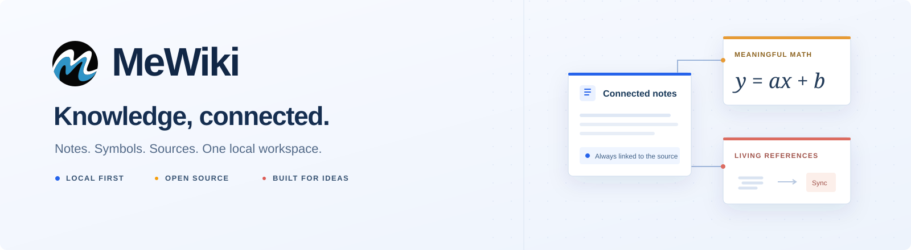
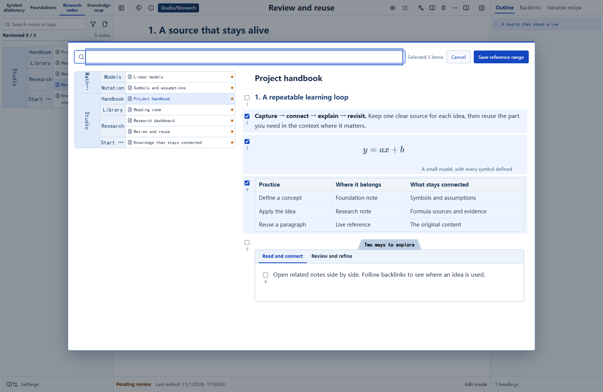

<div align="center">



**Bring pages, symbols, formulas, and references together. Keep reused content connected to its source.**

[简体中文](README.md) · [English](README.en.md)

<p>
  <a href="LICENSE"></a>
  <a href="https://nodejs.org/"></a>
  <a href="https://react.dev/"></a>
  <a href="https://www.typescriptlang.org/"></a>
  <a href="#your-files-your-storage"></a>
  <a href="#chinese-and-english-interface"></a>
</p>

[Quick start](#quick-start) · [Gallery](#gallery) · [User manual](docs/wiki/README.md) · [Integration API](docs/integrations/README.md) · [Feedback](https://github.com/tojayon/MeWiki/issues)

</div>

MeWiki is a local-first wiki for writing and managing connected knowledge. Organize pages with hierarchical tags, explain notation in a symbol dictionary, and keep formulas, PDFs, citations, media, and datasets in the same note. Live references, backlinks, and knowledge maps make their relationships visible.

Use it for a personal knowledge base, technical documentation, study notes, or research records. New workspaces include a complete Chinese manual and a small set of general examples you can read, edit, or remove.


## Highlights

| What you want to do | How MeWiki helps |
| --- | --- |
| Edit once and update related pages | Reference selected blocks from another note and display the latest source content in place |
| Explain every variable in a formula | Symbol dictionary, per-position descriptions, visual scripts, formula sources, and variable dependencies |
| Keep writing and supporting material together | Images, audio, video, PDFs, attachments, web cards, and DOI metadata |
| Work through data and derivations | CSV/Excel, charts, Mermaid, freehand drawing, and knowledge maps |
| Separate personal and project material | Multiple local libraries, independent windows, history, and backups with attachments |
| Bring context from other applications | A versioned host SDK and optional plugins with links back to the original source |

## Gallery

### Editable formulas, meaningful symbols

Choose a dictionary symbol and edit its scripts on the left; insert operators from a keyboard-like palette on the right. Keep inserting without closing the editor, copy and paste formula items, drag to reorder, or preview LaTeX as you type. Variables in inline formulas can also open their definitions.

<table>
  <tr>
    <td width="50%"></td>
    <td width="50%"></td>
  </tr>
  <tr>
    <td align="center"><strong>Visual formula editor</strong><br />Symbols, scripts, operators, and LaTeX</td>
    <td align="center"><strong>Symbol dictionary</strong><br />Position meanings, defined results, and usage</td>
  </tr>
</table>

### Reference the source. Read the content.

Choose paragraphs, formulas, images, or tabs from another note and show them directly in the current page. The source picker renders the original content for reading and selection. Stable identifiers keep references connected when the source is renamed or updated.



Referenced content is read-only; edit it in the source note. Backlinks show where it is used, missing sources remain identifiable, and circular references are checked. See [links and live references](docs/wiki/07-links-and-references.md) in the Chinese manual.

### More than text on a page

Read PDFs, retrieve citation metadata from a DOI, embed media, and place datasets, charts, and diagrams alongside your writing. Save originals to a local library and move them with a backup that includes attachments.


### Explore relationships. Keep libraries separate.

Knowledge maps connect pages, formulas, and conditions. Multiple libraries keep personal and project material in separate directories while sharing one application. Each window retains its own library selection.

<table>
  <tr>
    <td width="50%"></td>
    <td width="50%"></td>
  </tr>
  <tr>
    <td align="center"><strong>Knowledge maps</strong><br />Global, topic, and per-note derivation views</td>
    <td align="center"><strong>Multiple libraries</strong><br />Separate directories, windows, and backups</td>
  </tr>
</table>

All screenshots use general examples and fictional data. They contain no personal research notes or attachments.

## Quick start

Install **Node.js 22.13 or a newer supported release**, npm, and Git.

```sh
git clone https://github.com/tojayon/MeWiki.git
cd MeWiki
npm ci
npm run build
npm start
```

Open **[http://127.0.0.1:5280](http://127.0.0.1:5280)** and keep the terminal running. You can also download the source ZIP, extract it, and run the last three commands inside the project directory.

On Windows, double-click `Start-MeWiki.bat`. The cross-platform launcher command is `node scripts/start-mewiki.mjs`; it prepares dependencies, builds the application, and opens the browser. Rebuild and restart MeWiki after updating the source.

The first installation and dependency updates require network access. After installation, local content can be edited and viewed offline; online media and metadata lookup still need a connection. The primary validation environment is **Windows + Microsoft Edge**. Other platforms still need additional device testing.

## Chinese and English interface

MeWiki supports **简体中文 / English**. Switch languages using the interface language control without reloading; your preference is saved. Menus, action hints, and date formatting follow the selected language.

Note content, page titles, symbol names, tags, and attachments remain as authored. Changing the interface language does not translate or rewrite them. The complete 20-page user manual is currently in Chinese; this English README provides the installation and feature overview.

## Your files, your storage

| Mode | Location | Per-original limit | Best for |
| --- | --- | --- | --- |
| Browser storage | Storage for the current site in your browser | 100 MB | Trying the app and smaller libraries |
| Local library | A directory you choose, with originals in `assets/` | 1 GB | Regular use and large attachments |

Importing a local file creates a copy and preserves the original. Storage limits do not imply preview support: formats, encodings, and preview sizes still depend on the browser and content type. See [media](docs/wiki/10-media.md) and [documents and attachments](docs/wiki/11-documents-and-attachments.md) in the Chinese manual.

Before migrating or updating, export a **ZIP backup with attachments** or back up the complete library directory. Plain JSON and Markdown do not include original attachment bytes. Local library registration lives in `.mewiki/`; keep these machine settings and user files out of source control.

MeWiki currently runs as a local single-user application and binds to `127.0.0.1` by default. The complete app requires its local Node service; static GitHub Pages cannot replace the library and media APIs. Cloud sync, accounts, and real-time collaboration are not currently included.

## Documentation

The linked guides are currently in Chinese.

| Guide | What it covers |
| --- | --- |
| [Complete user manual](docs/wiki/README.md) | 20 manual pages, from your first note to backups and plugins |
| [Symbol dictionary](docs/wiki/05-symbol-dictionary.md) / [Formula editing](docs/wiki/06-formulas.md) | Notation, scripts, copy and paste, and sources |
| [Links and references](docs/wiki/07-links-and-references.md) | Live block references, backlinks, and split reading |
| [Storage and backups](docs/wiki/15-storage-and-backup.md) | Storage locations, history, conflicts, and attachment recovery |
| [Plugins and external applications](docs/wiki/19-plugins-and-integrations.md) | Optional WebBench replay plugin and source navigation |
| [Development guide](docs/DEVELOPMENT.md) | Project structure, shared components, and conventions |
| [Integration API](docs/integrations/README.md) | External content format, host SDK, and plugins |
| [Changelog](CHANGELOG.md) / [Roadmap](docs/ROADMAP.md) | Current capabilities and planned work |

## Contributing

```sh
npm run dev        # Development server
npm run check      # Translation checks, lint, unit tests, and build
npm run test:e2e   # Edge browser checks
```

Tests use isolated data. Do not connect real libraries during development. Daily use does not require WebBench; starting its services is only necessary for the replay plugin’s source operations.

Report reproducible bugs and feature ideas through [Issues](https://github.com/tojayon/MeWiki/issues), and read the [contribution guide](CONTRIBUTING.md) before proposing changes. For security issues, use the enabled [private vulnerability report](https://github.com/tojayon/MeWiki/security/advisories/new); see [SECURITY.md](SECURITY.md).

## License

MeWiki-owned source code and documentation use the **[MIT License](LICENSE)**. Dependencies, fonts, and codecs retain their own licenses; see [third-party notices](THIRD_PARTY_NOTICES.md). Users’ notes, attachments, and referenced materials retain their original ownership and rights.
