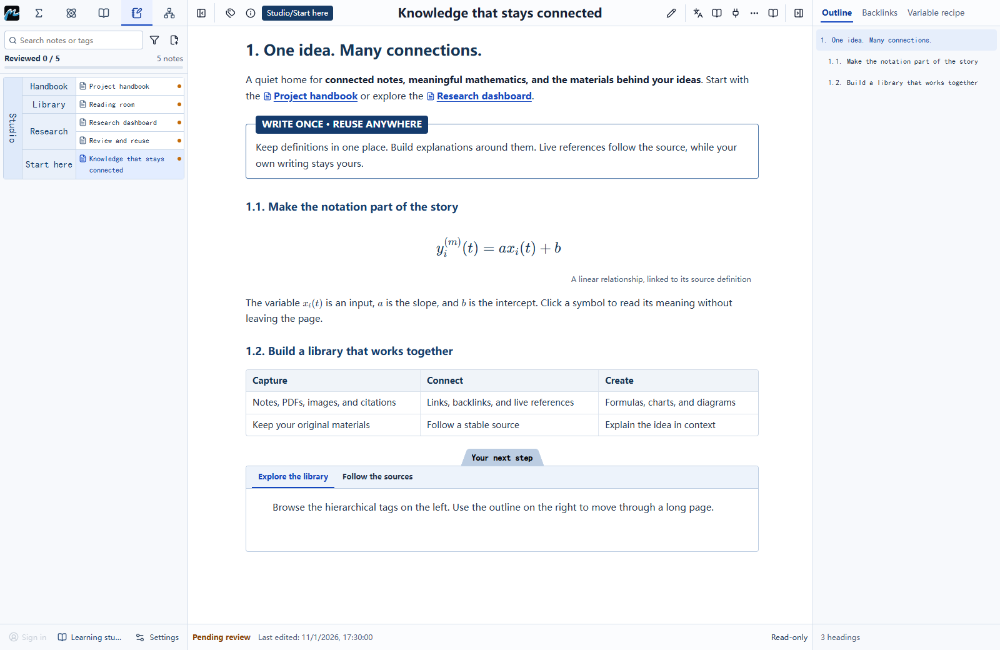
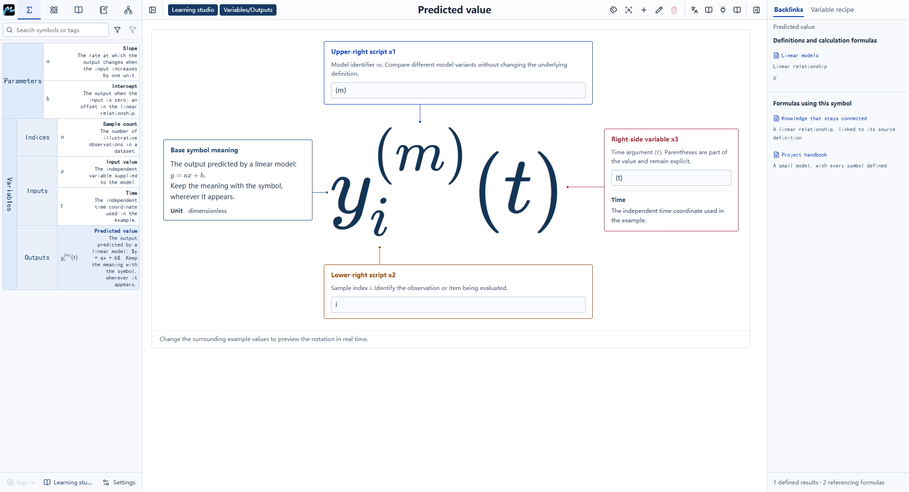
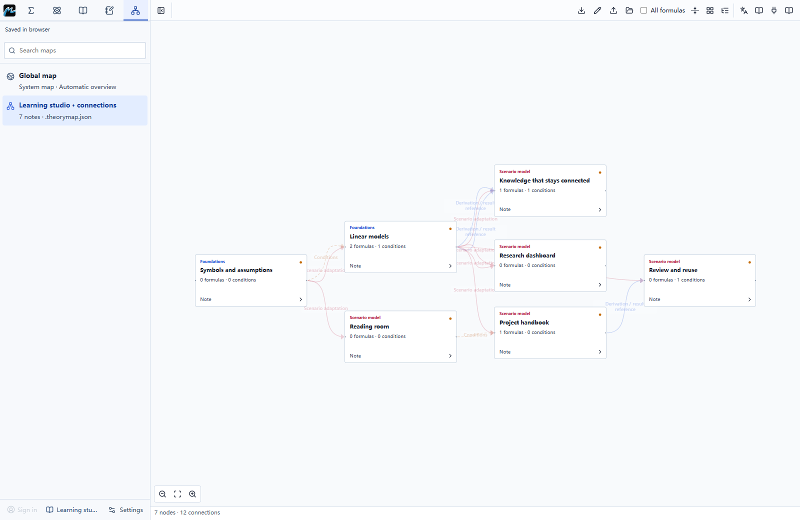

<div align="center">


<h1>MeWiki</h1>
<h3>Knowledge, connected.</h3>

A local-first personal wiki that connects pages, terms, formulas, and their sources.

<p>
  <a href="LICENSE"></a>
  <a href="https://nodejs.org/"></a>
  <a href="#your-files-your-storage"></a>
  <a href="#chinese-and-english-interface"></a>
</p>

[Philosophy](#philosophy) · [Gallery](#gallery) · [Quick start](#quick-start) · [User manual](docs/wiki/README.md)

[简体中文](README.md) · [English](README.en.md) · [Logos and app icons](docs/BRANDING.md)

</div>

MeWiki is an open-source local wiki for personal knowledge bases, technical documentation, study notes, and research records. Maintain definitions in foundation notes and use them in research notes. Explain terms and symbols in dictionaries, then connect ideas to their sources with live references and knowledge maps.

New workspaces include a complete Chinese manual and general examples. Start with a single note.



## Philosophy

**Knowledge, connected — with context you can follow.** Four ideas guide MeWiki:

- **Keep knowledge connected.** Page links, backlinks, and knowledge maps place a definition alongside the notes, formulas, and conditions that use it.
- **Maintain the source. Reuse it wherever it helps.** Reference an explanation or a group of formulas in several notes. Each reference displays the current source content, while your commentary stays in its own page.
- **Let expression follow thought.** Write text, mathematical notation, charts, and supporting material together. Open a term or symbol to read its meaning; follow a derivation back to its foundations.
- **Keep your work in your hands.** Choose a local library directory, use version history, export JSON or Markdown, and back up your notes with their attachments as your library grows.

A typical workflow is **collect → explain → connect → reuse and share**. Save a PDF, take reading notes, define the terms and symbols, reference key passages in a research note, then export the part you want to share.

## Features

| What you want to do | How MeWiki helps |
| --- | --- |
| Edit once and update related pages | Reference selected blocks from another note and display the latest source content in place |
| Explain concepts and mathematical notation | Separate term and symbol dictionaries, alias and abbreviation references, position descriptions, visual scripts, and formula sources |
| Keep writing and supporting material together | Images, audio, video, PDFs, attachments, web cards, and DOI metadata |
| Work through data and derivations | CSV/Excel, charts, Mermaid, freehand drawing, and knowledge maps |
| Separate personal and project material | Multiple local libraries, independent windows, history, and backups with attachments |
| Turn a note into images to share | PNG/JPEG export, multiple pages or a long image, covers, personal presets, and accompanying text |
| Bring context from other applications | A versioned host SDK and locally installable declarative plugins with links back to the original source |

## Gallery

### Defined concepts, meaningful formulas

Give a term its canonical name, English name, abbreviations, and aliases. Type `#` in your writing to choose a reference form. Describe the base, scripts, and variables of a symbol. While reading, click a reference to open its explanation without leaving the page.

The formula editor provides dictionary symbols, visual scripts, an operator keyboard, continuous insertion, copy and paste, drag ordering, and live LaTeX previews.

<table>
  <tr>
    <td width="50%"></td>
    <td width="50%"></td>
  </tr>
  <tr>
    <td align="center"><strong>Visual formula editor</strong><br />Symbols, scripts, operators, and LaTeX</td>
    <td align="center"><strong>Symbol dictionary</strong><br />Position meanings, defined results, and usage</td>
  </tr>
</table>

### Reference the source. Read the content.

Choose paragraphs, formulas, images, or tabs from another note and show them directly in the current page. The source picker renders the original content for reading and selection. Stable identifiers keep references connected when the source is renamed or updated.


Referenced content is read-only; edit it in the source note. Backlinks show where it is used, missing sources remain identifiable, and circular references are checked. See [links and live references](docs/wiki/07-links-and-references.md) in the Chinese manual.

### More than text on a page

Read PDFs, retrieve citation metadata from a DOI, embed media, and place datasets, charts, and diagrams alongside your writing. Save originals to a local library and move them with a backup that includes attachments.


### Explore relationships. Keep libraries separate.

Knowledge maps connect pages, formulas, and conditions. Multiple libraries keep personal and project material in separate directories while sharing one application. Each window retains its own library selection.

<table>
  <tr>
    <td width="50%"></td>
    <td width="50%"></td>
  </tr>
  <tr>
    <td align="center"><strong>Knowledge maps</strong><br />Global, topic, and per-note derivation views</td>
    <td align="center"><strong>Multiple libraries</strong><br />Separate directories, windows, and backups</td>
  </tr>
</table>

### From your notes to images you can share

Install and enable the bundled Social image export plugin, then open its workspace in a separate browser tab from the note menu. Choose the content, canvas, and preset, preview the result, and download PNG, JPEG, or an image ZIP with accompanying text. Save, import, and export personal presets to use with your next note. See the [image export guide](docs/wiki/20-social-export.md).

### Connect other tools when you need them

Manage bundled plugins in Settings → Plugins and integrations, or install declarative content plugins and export presets from a local JSON, ZIP, or `.mewiki-plugin` file. External cards retain their source locations, and disabling a plugin preserves existing note content. Developers can start with the [plugin guide](docs/plugins/README.md) and [host SDK](docs/integrations/README.md).

All screenshots use general examples and fictional data. They contain no personal research notes or attachments.

## Quick start

Install **Node.js 22.13 or a newer supported release**, npm, and Git.

```sh
git clone https://github.com/tojayon/MeWiki.git
cd MeWiki
npm ci
npm run build
npm start
```

Open **[http://127.0.0.1:5280](http://127.0.0.1:5280)** and keep the terminal running. You can also download the source ZIP, extract it, and run the last three commands inside the project directory.

On Windows, double-click `Start-MeWiki.bat`. The cross-platform launcher command is `node scripts/start-mewiki.mjs`; it prepares dependencies, builds the application, and opens the browser. Rebuild and restart MeWiki after updating the source.

The first installation and dependency updates require network access. After installation, local content can be edited and viewed offline; online media and metadata lookup still need a connection. The primary validation environment is **Windows + Microsoft Edge**. Other platforms still need additional device testing.

## Chinese and English interface

MeWiki supports **简体中文 / English**. Switch in Settings → General without reloading; your preference is saved. Menus, action hints, and date formatting follow the selected language.

Note content, page titles, dictionary names, tags, and attachments remain as authored. The complete user manual is currently in Chinese; this English README provides the installation and feature overview.

## Your files, your storage

| Mode | Location | Per-original limit | Best for |
| --- | --- | --- | --- |
| Browser storage | Storage for the current site in your browser | 100 MB | Trying the app and smaller libraries |
| Local library | A directory you choose, with originals in `assets/` | 1 GB | Regular use and large attachments |

Importing a local file creates a copy and preserves the original. Storage limits do not imply preview support: formats, encodings, and preview sizes still depend on the browser and content type. See [media](docs/wiki/10-media.md) and [documents and attachments](docs/wiki/11-documents-and-attachments.md) in the Chinese manual.

Before migrating or updating, export a **ZIP backup with attachments** or back up the complete library directory. Plain JSON and Markdown do not include original attachment bytes. Local library registration lives in `.mewiki/`; keep these machine settings and user files out of source control.

## FAQ

**Does it work offline?** After installation, you can edit notes, formulas, and local attachments offline. Web content, online media, and DOI metadata lookup need a connection.

**Do I need an account or a cloud service?** MeWiki is currently a local single-user application that binds to `127.0.0.1` by default and uses local data directly. Cloud sync, accounts, and real-time collaboration are not yet available.

**Can I deploy it to GitHub Pages?** The complete app depends on a local Node service for library, attachment, and export APIs. Static hosting cannot provide those services.

**What do plugins support?** Locally installed declarative content and export presets are available now. Executable scripts, general editor extensions, and an online community directory are covered in the [future design](docs/plugins/ARCHITECTURE.md). Daily use does not require WebBench; its services are only needed for the replay plugin's source operations.

## Documentation

The linked guides are currently in Chinese.

| Guide | What it covers |
| --- | --- |
| [Complete user manual](docs/wiki/README.md) | From your first note to content examples, backups, and plugins |
| [Term and symbol dictionaries](docs/wiki/05-symbol-dictionary.md) / [Formula editing](docs/wiki/06-formulas.md) | Canonical names, abbreviations, notation, scripts, and sources |
| [Links and references](docs/wiki/07-links-and-references.md) | Live block references, backlinks, and split reading |
| [Storage and backups](docs/wiki/15-storage-and-backup.md) | Storage locations, history, conflicts, and attachment recovery |
| [Plugins and external applications](docs/wiki/19-plugins-and-integrations.md) / [Image export](docs/wiki/20-social-export.md) | Local installation, source navigation, images, and personal presets |
| [Development guide](docs/DEVELOPMENT.md) | Project structure, shared components, and conventions |
| [AI handoff guide](docs/AI_HANDOFF.md) | Continuation workflow, data boundaries, isolated checks, and next steps |
| [Plugin development](docs/plugins/README.md) / [Ecosystem proposal](docs/plugins/ARCHITECTURE.md) | Declarative API v1, local installation, examples, and future community plans |
| [Integration API](docs/integrations/README.md) | External content format, host SDK, and plugins |
| [Logos and app icons](docs/BRANDING.md) | Circular mark, square app icons, SVG, and high-resolution PNG |
| [Changelog](CHANGELOG.md) / [Roadmap](docs/ROADMAP.md) | Current capabilities and planned work |

## Contributing

```sh
npm run dev        # Development server
npm run check      # Translation checks, lint, unit tests, and build
npm run test:e2e   # Edge browser checks
```

The application uses React and TypeScript, with fonts, PDF resources, and graphics rendering resources bundled locally. Tests use isolated data; do not connect real libraries during development. See the [development guide](docs/DEVELOPMENT.md) for environment setup and full validation steps.

Report reproducible bugs and feature ideas through [Issues](https://github.com/tojayon/MeWiki/issues), and read the [contribution guide](CONTRIBUTING.md) before proposing changes. For security issues, use the enabled [private vulnerability report](https://github.com/tojayon/MeWiki/security/advisories/new); see [SECURITY.md](SECURITY.md).

## License

MeWiki-owned source code and documentation use the **[MIT License](LICENSE)**. Dependencies, fonts, and codecs retain their own licenses; see [third-party notices](THIRD_PARTY_NOTICES.md). Users’ notes, attachments, and referenced materials retain their original ownership and rights.
