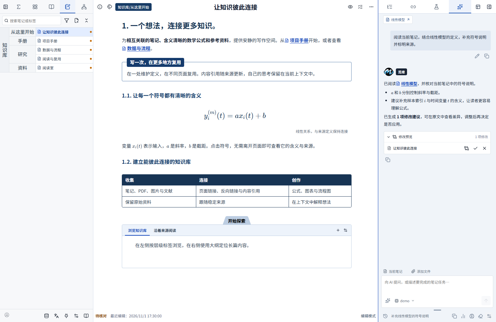
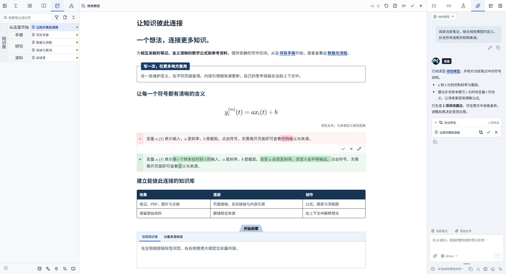
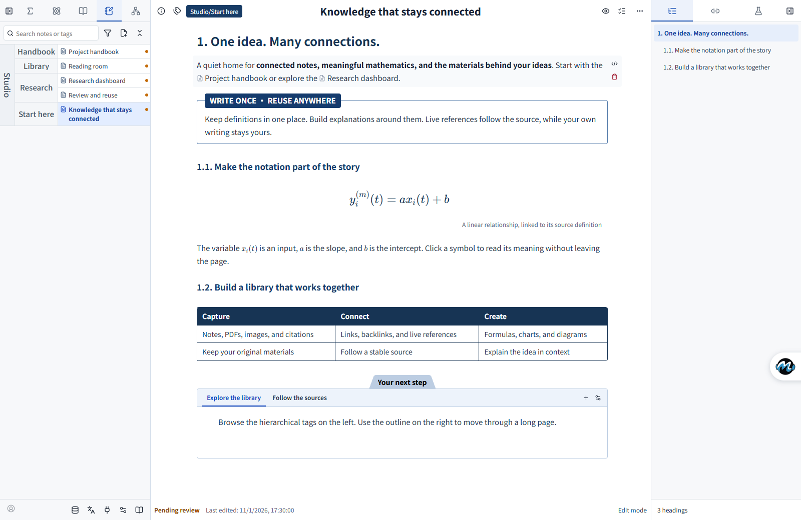
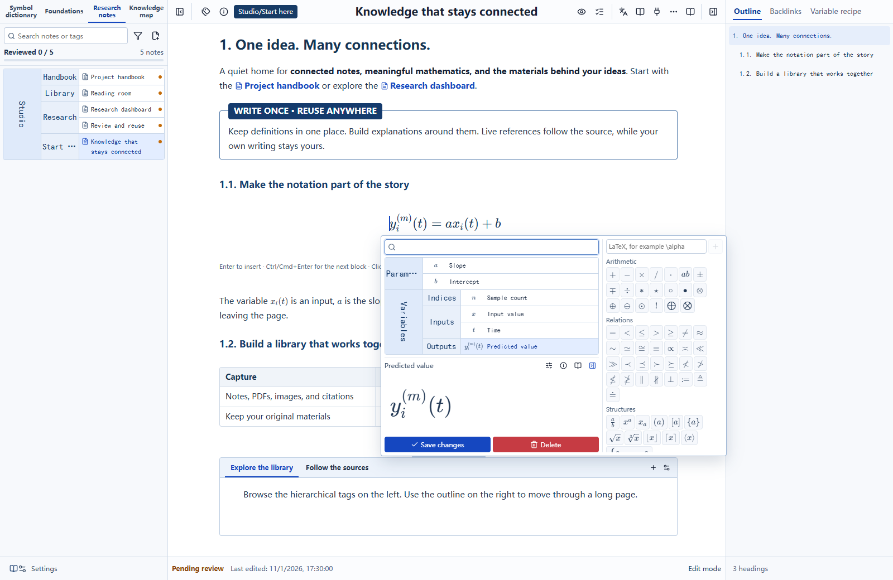
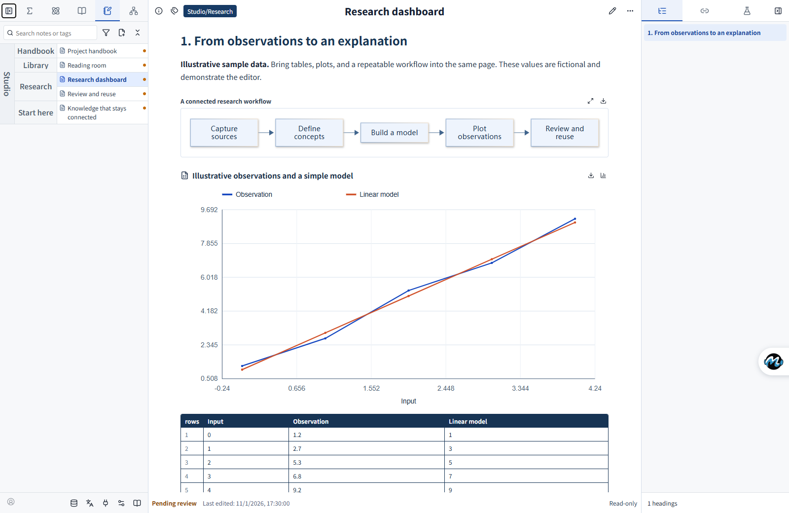
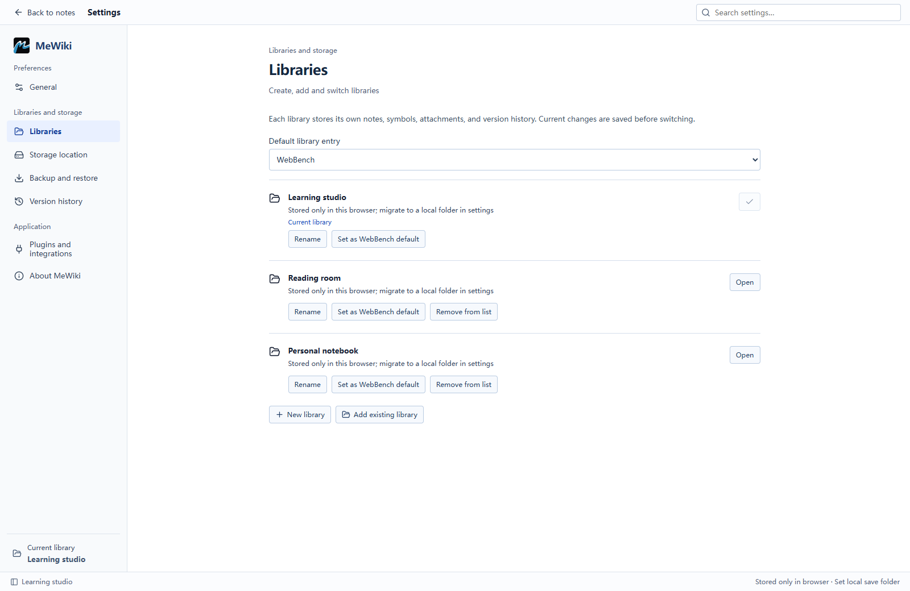

<div align="center">


<h1>MeWiki</h1>
<h3>Seek knowledge. Connect everything across dimensions.</h3>

A local-first personal wiki that connects pages, terms, formulas, and their sources, with an AI assistant for your knowledge work.

<p>
  <a href="LICENSE"></a>
  <a href="https://nodejs.org/"></a>
  <a href="#your-files-your-storage"></a>
  <a href="#chinese-and-english-interface"></a>
</p>

[Use online](https://wiki.mecore.cc) · [Philosophy](#philosophy) · [AI assistant](#ai-assistant) · [Gallery](#gallery) · [Install locally](#quick-start) · [User manual](docs/wiki/README.md)

[简体中文](README.md) · [English](README.en.md) · [Logos and app icons](docs/BRANDING.md)

</div>

MeWiki is an open-source local wiki for personal knowledge bases, technical documentation, study notes, and research records. Maintain definitions in foundation notes and use them in research notes. Explain terms and symbols in dictionaries, then connect ideas to their sources with live references and knowledge maps.

Its Chinese name is **觅维** (Mìwéi): 觅 means exploring and seeking knowledge; 维 means dimensions, connection, and continuity. The name echoes Me, the M logo, and Wiki. See the [brand notes](docs/BRANDING.md#中文名称与释义).

New workspaces include a complete Chinese manual and general examples. Start with a single note. Optionally connect your own AI service to search notes, understand supporting material, and review proposed changes in context.


## Official hosted service

**[Open MeWiki → wiki.mecore.cc](https://wiki.mecore.cc)** to use it in your browser without installation. Existing accounts sign in through **MeAccount** to access the [workspace](https://wiki.mecore.cc/workspace). Manage your shared avatar and profile in the [account center](https://accounts.mecore.cc/profile/). Account access is currently controlled; check the sign-in page for available registration options.

- **Try it first.** Choose “立即体验” (Try now) on the homepage for an isolated temporary space without registering. A guest space lasts up to 2 hours, expires after 30 minutes of inactivity, and allows 20 notes / 5 MiB of content, without attachment uploads. Signing in does not merge guest content; export anything you want to keep before it expires.
- **Choose your version.** The hosted service supports online notes, dictionaries, maps, attachments, history, and backup exchange. This repository provides the open-source local version, including offline use, your own AI services, and plugins. Hosted AI, plugin installation, web / DOI metadata fetching, and local directory / font services are not yet available. The full feature tour below describes the local version.
- **Move existing notes.** Export a **ZIP backup with attachments** from local Settings → Backup and restore. Sign into a regular hosted account, select the destination library, preview the backup, and confirm the import. Library names can differ. Import replaces the destination's current content, so back it up first.

There is **no automatic two-way sync** between local and hosted libraries. Local data stays on your machine; regular hosted data is stored on the server and isolated by account and workspace. Expired guest spaces are cleaned up. The hosted service is still evolving; keep independent backups of important data. See the [hosted service guide](docs/HOSTED.en.md) for scope, limits, and migration steps.

## Philosophy

**Seek knowledge. Connect everything across dimensions.** Four ideas guide MeWiki:

- **Keep knowledge connected.** Page links, backlinks, and knowledge maps place a definition alongside the notes, formulas, and conditions that use it.
- **Maintain the source. Reuse it wherever it helps.** Reference an explanation or a group of formulas in several notes. Each reference displays the current source content, while your commentary stays in its own page.
- **Let expression follow thought.** Write text, mathematical notation, charts, and supporting material together. Open a term or symbol to read its meaning; follow a derivation back to its foundations.
- **Keep your work in your hands.** Choose a local library directory, use version history, export JSON or Markdown, and back up your notes with their attachments as your library grows.

A typical workflow is **collect → explain → connect → reuse and share**. Save a PDF, take reading notes, define the terms and symbols, reference key passages in a research note, then export the part you want to share.

## Features

| What you want to do | How MeWiki helps |
| --- | --- |
| Read, organize, and revise knowledge with AI | Your choice of model and service, note search, supporting files, in-context review, approval, and undo |
| Edit the formatting you see | WYSIWYG headings, emphasis, lists, and quotes, with a Markdown source toggle |
| Edit once and update related pages | Reference selected blocks from another note and display the latest source content in place |
| Explain concepts and mathematical notation | Separate term and symbol dictionaries, alias and abbreviation references, position descriptions, visual scripts, and formula sources |
| Keep writing and supporting material together | Images, audio, video, PDFs, attachments, web cards, and DOI metadata |
| Work through data and derivations | CSV/Excel, charts, Mermaid, freehand drawing, and knowledge maps |
| Separate personal and project material | Multiple local libraries, independent windows, history, and backups with attachments |
| Turn a note into images to share | PNG/JPEG export, multiple pages or a long image, covers, personal presets, and accompanying text |
| Bring context from other applications | A versioned host SDK and locally installable declarative plugins with links back to the original source |

## AI assistant

Let AI find evidence across your notes and definitions, then review its changes where they belong. Open the assistant from the avatar at the window edge, move and resize the chat, or dock it in the right sidebar. Keep reading, navigating the outline, and discussing your notes together.

<table>
  <tr>
    <td width="50%"></td>
    <td width="50%"></td>
  </tr>
  <tr>
    <td align="center"><strong>Discuss with sources</strong><br />Note search, supporting files, and ongoing conversations</td>
    <td align="center"><strong>Review in context</strong><br />Rendered comparisons, editable suggestions, approval, and undo</td>
  </tr>
</table>

- **Make context explicit through one `@` entry.** Reference notes, symbols, terms, maps, or product modules within a sentence, pin the current object, or explicitly enable library search. Removable labels show the active context; choosing another object does not silently include the open note. Select text and press `Alt+Enter`, or choose Send to AI from a content row menu, to limit a task to its actual source range.
- **Keep rules and skills with each library.** Save library guidance, manage and select skills, use templates, and import or export Markdown. Recommended skills require your explicit selection. Each task freezes its rules and references; retries and continuation reuse that snapshot.
- **Bring supporting files.** Add PDF, DOCX, TXT, Markdown, TeX, code, CSV, or XLSX files, preview extracted text locally, then let AI search the material as needed. PDF references can identify pages; spreadsheets can identify worksheets. Scanned PDFs need text recognition first.
- **Approve before saving.** Changes to notes, content blocks, tabs, dictionaries, and knowledge maps become proposals. Review red deletions and green additions in context, switch between stacked and side-by-side comparisons, edit the green suggestion, then approve individually or by page. Undo and reapply accepted changes. Selection boundaries and independent manual edits are protected; conflicts preserve the current content.
- **Keep your progress.** Conversations, input drafts, pinned instructions, and token records are saved separately for each library. Edit earlier prompts, retry explicitly, or continue the remaining work of a partially completed task. Expand tool records to jump to sources. Reloading never sends a request automatically.

In the **local version, open Settings → AI services** and add your API address, protocol, key, and model. MeWiki supports OpenAI Chat Completions, OpenAI Responses, and Anthropic Messages compatible endpoints, including local models that provide a compatible API. Confirm the context through `@` and send a request such as:

> Read the current note, check its notation against the symbol dictionary, and suggest additions based on the files I attached. Cite your sources.

Requests pass through the local MeWiki service to your chosen model provider. That provider receives the conversation and authorized material read for the task, and bills under its own terms. MeWiki includes no model or usage credits. Keys are stored separately from notes; chats and extracted supporting-file snapshots are outside note backups. See the [AI workspace guide](docs/wiki/22-ai-workspace.md) for setup, supported operations, and data handling.

## Gallery

### Edit directly in the rendered page

Click text to type in place while headings, emphasis, lists, quotes, and inline formulas keep their formatting. The same editing works in callouts, tabs, and table cells. Click a term or symbol to inspect its definition, or press `F2` to change that reference. Switch to Markdown source when you need the original markup.



### Defined concepts, meaningful formulas

Give a term its canonical name, English name, abbreviations, and aliases. Type `#` in your writing to choose a reference form. Describe the base, scripts, and variables of a symbol. While reading, click a reference to open its explanation without leaving the page.

The formula editor provides dictionary symbols, visual scripts, an operator keyboard, continuous insertion, copy and paste, drag ordering, and live LaTeX previews.

<table>
  <tr>
    <td width="50%"></td>
    <td width="50%"></td>
  </tr>
  <tr>
    <td align="center"><strong>Visual formula editor</strong><br />Symbols, scripts, operators, and LaTeX</td>
    <td align="center"><strong>Symbol dictionary</strong><br />Position meanings, defined results, and usage</td>
  </tr>
</table>

### Reference the source. Read the content.

Choose paragraphs, formulas, images, or tabs from another note and show them directly in the current page. The source picker renders the original content for reading and selection. Stable identifiers keep references connected when the source is renamed or updated.


Referenced content is read-only; edit it in the source note. Backlinks show where it is used, missing sources remain identifiable, and circular references are checked. See [links and live references](docs/wiki/07-links-and-references.md) in the Chinese manual.

### More than text on a page

Read PDFs, retrieve citation metadata from a DOI, embed media, and place datasets, charts, and diagrams alongside your writing. Open flowcharts in a separate vector canvas, zoom with the wheel or a touch gesture, and pan to inspect nodes and connections. Save originals to a local library and move them with a backup that includes attachments.



### Explore relationships. Keep libraries separate.

Knowledge maps connect pages, formulas, and conditions. Multiple libraries keep personal and project material in separate directories while sharing one application. Each window retains its own library selection.

<table>
  <tr>
    <td width="50%"></td>
    <td width="50%"></td>
  </tr>
  <tr>
    <td align="center"><strong>Knowledge maps</strong><br />Global, topic, and per-note derivation views</td>
    <td align="center"><strong>Multiple libraries</strong><br />Separate directories, windows, and backups</td>
  </tr>
</table>

### From your notes to images you can share

Install and enable the bundled Social image export plugin, then open its workspace in a separate browser tab from the note menu. Choose the content, canvas, and preset, preview the result, and download PNG, JPEG, or an image ZIP with accompanying text. The native preset reuses note rendering; add your own fonts, layer background textures, apply device frames, or place text and stickers on individual or batch images. Save, import, and export personal presets to use with your next note. See the [image export guide](docs/wiki/20-social-export.md).

### Connect other tools when you need them

Manage bundled plugins in Settings → Plugins and integrations, or install declarative content plugins and export presets from a local JSON, ZIP, or `.mewiki-plugin` file. External cards retain their source locations, and disabling a plugin preserves existing note content. Developers can start with the [plugin guide](docs/plugins/README.md) and [host SDK](docs/integrations/README.md).

All screenshots use general examples and fictional data. AI demonstrations use preset conversations and proposals without calling a real model. They contain no personal research notes, credentials, or attachments.

## Quick start

To use the hosted service, open **[wiki.mecore.cc](https://wiki.mecore.cc)**. The steps below install this repository's local version, which needs no MeAccount account.

Install **Node.js 22.13 or a newer supported release**, npm, and Git.

```sh
git clone https://github.com/tojayon/MeWiki.git
cd MeWiki
npm ci
npm run build
npm start
```

Open **[http://127.0.0.1:5280](http://127.0.0.1:5280)** and keep the terminal running. You can also download the source ZIP, extract it, and run the last three commands inside the project directory.

On Windows, double-click `Start-MeWiki.bat`. The cross-platform launcher command is `node scripts/start-mewiki.mjs`; it prepares dependencies, builds the application, and opens the browser. Rebuild and restart MeWiki after updating the source.

The first installation and dependency updates require network access. After installation, local content can be edited and viewed offline; online media and metadata lookup still need a connection. The primary validation environment is **Windows + Microsoft Edge**. Other platforms still need additional device testing.

## Chinese and English interface

MeWiki supports **简体中文 / English**. Switch from the language button at the bottom of the left sidebar or in Settings → General without reloading; your preference is saved. Menus, action hints, and date formatting follow the selected language. The sidebar footer also offers quick library switching and plugin toggles. Collapsed sidebars retain icon rails for temporary access to their panels.

Import your own fonts in Settings → General → Interface fonts, and [adjust interface and note text sizes separately](docs/wiki/02-workspace.md#分别调整界面与正文字号). Preferences are saved per library, independently of export presets.

Note content, page titles, dictionary names, tags, and attachments remain as authored. The complete user manual is currently in Chinese; this English README provides the installation and feature overview.

## Your files, your storage

The following storage options apply to the local version. Hosted data and attachments are stored on the server; see [hosted storage and backups](docs/HOSTED.en.md#data-and-backups) for limits and migration.

| Mode | Location | Per-original limit | Best for |
| --- | --- | --- | --- |
| Browser storage | Storage for the current site in your browser | 100 MB | Trying the app and smaller libraries |
| Local library | A directory you choose, with originals in `assets/` | 1 GB | Regular use and large attachments |

Importing a local file creates a copy and preserves the original. Storage limits do not imply preview support: formats, encodings, and preview sizes still depend on the browser and content type. See [media](docs/wiki/10-media.md) and [documents and attachments](docs/wiki/11-documents-and-attachments.md) in the Chinese manual.

Before migrating or updating, export a **ZIP backup with attachments** or back up the complete library directory. Plain JSON and Markdown do not include original attachment bytes. Local library registration lives in `.mewiki/`; keep these machine settings and user files out of source control.

## FAQ

**Does it work offline?** After installation, you can edit notes, formulas, and local attachments offline. Web content, online media, and DOI metadata lookup need a connection.

**Does AI upload my whole library or change notes automatically?** Tools read needed material within the scope you choose, and you explicitly attach supporting files. Cloud models receive the conversation and reading results. Changes remain proposals until you review and apply them. Offline inference requires a separately running local model with a compatible API.

**Do I need an account or a cloud service?** This repository's local version needs no account, binds to `127.0.0.1` by default, and uses local data directly. The official hosted service uses MeAccount and offers isolated temporary guest access. Automatic local / hosted sync and real-time collaboration are not currently available.

**Does this repository include the hosted backend?** It contains the open-source local version and shared note core. Accounts, online storage, and production deployment are maintained in a separate server edition. The hosted launch does not mean a complete multi-user self-hosting backend is included here.

**Can I deploy it to GitHub Pages?** The complete app depends on a local Node service for library, attachment, and export APIs. Static hosting cannot provide those services.

**What do plugins support?** Locally installed declarative content and export presets are available now. Executable scripts, general editor extensions, and an online community directory are covered in the [future design](docs/plugins/ARCHITECTURE.md). Daily use does not require WebBench; its services are only needed for the replay plugin's source operations.

## Documentation

The hosted service guide is available in English; the linked user manual and development guides are currently in Chinese.

| Guide | What it covers |
| --- | --- |
| [Complete user manual](docs/wiki/README.md) | From your first note to content examples, backups, and plugins |
| [Hosted service guide](docs/HOSTED.en.md) | Official URLs, MeAccount sign-in, guest access, version scope, and migration |
| [Term and symbol dictionaries](docs/wiki/05-symbol-dictionary.md) / [Formula editing](docs/wiki/06-formulas.md) | Canonical names, abbreviations, notation, scripts, and sources |
| [Links and references](docs/wiki/07-links-and-references.md) | Live block references, backlinks, and split reading |
| [AI workspace](docs/wiki/22-ai-workspace.md) | Your own services, supporting files, selection tasks, review, memory, and recovery |
| [Storage and backups](docs/wiki/15-storage-and-backup.md) | Storage locations, history, conflicts, and attachment recovery |
| [Plugins and external applications](docs/wiki/19-plugins-and-integrations.md) / [Image export](docs/wiki/20-social-export.md) | Local installation, source navigation, images, and personal presets |
| [Development guide](docs/DEVELOPMENT.md) | Project structure, shared components, and conventions |
| [Edition maintenance](docs/EDITION_MAINTENANCE.md) | Community-to-server integration, adapter differences, publication guards, and workspace conventions (Chinese) |
| [AI handoff guide](docs/AI_HANDOFF.md) | Continuation workflow, data boundaries, isolated checks, and next steps |
| [AI architecture](docs/ai/ARCHITECTURE.md) / [Offline evaluation](docs/ai/EVALUATION.md) | Readable projections, tool permissions, proposal persistence, and fictional evaluation tasks |
| [Plugin development](docs/plugins/README.md) / [Ecosystem proposal](docs/plugins/ARCHITECTURE.md) | Declarative API v1, local installation, examples, and future community plans |
| [Integration API](docs/integrations/README.md) | External content format, host SDK, and plugins |
| [Logos and app icons](docs/BRANDING.md) | Circular mark, square app icons, SVG, and high-resolution PNG |
| [Changelog](CHANGELOG.md) / [Roadmap](docs/ROADMAP.md) | Current capabilities and planned work |

## Contributing

```sh
npm run dev        # Development server
npm run check      # Brand and translation checks, lint, unit tests, and build
npm run test:e2e   # Edge browser checks
npm run ai:evaluate # Fixed offline AI tasks; no real model calls
```

The application uses React and TypeScript, with fonts, PDF resources, and graphics rendering resources bundled locally. Tests use isolated data; do not connect real libraries during development. See the [development guide](docs/DEVELOPMENT.md) for environment setup and full validation steps.

Report reproducible bugs and feature ideas through [Issues](https://github.com/tojayon/MeWiki/issues), and read the [contribution guide](CONTRIBUTING.md) before proposing changes. For security issues, use the enabled [private vulnerability report](https://github.com/tojayon/MeWiki/security/advisories/new); see [SECURITY.md](SECURITY.md).

## License

MeWiki-owned source code and documentation use the **[MIT License](LICENSE)**. Dependencies, fonts, and codecs retain their own licenses; see [third-party notices](THIRD_PARTY_NOTICES.md). Users’ notes, attachments, and referenced materials retain their original ownership and rights.
