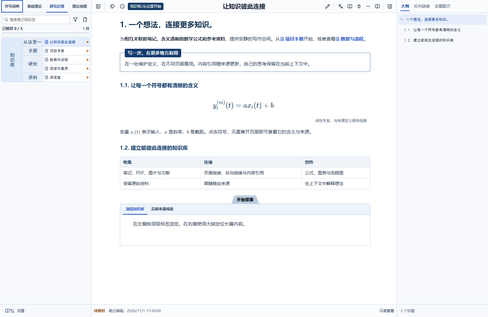

<div align="center">


**把页面、符号、公式与资料放在一起，让复用的内容随来源更新。**

[简体中文](README.md) · [English](README.en.md)

<p>
  <a href="LICENSE"></a>
  <a href="https://nodejs.org/"></a>
  <a href="https://react.dev/"></a>
  <a href="https://www.typescriptlang.org/"></a>
  <a href="#资料保存在你选择的地方"></a>
  <a href="#中英文界面"></a>
</p>

[快速开始](#快速开始) · [功能画廊](#功能画廊) · [完整手册](docs/wiki/README.md) · [开放接口](docs/integrations/README.md) · [反馈建议](https://github.com/tojayon/MeWiki/issues)

</div>

MeWiki 是本地优先的 Wiki 文档编辑与知识管理工具。用层级标签组织页面，用符号词典解释数学记号，把公式、PDF、文献、媒体和数据放进同一篇笔记，再通过内容引用、反向链接和理论地图串起它们之间的关系。

适合个人知识库、技术文档、学习笔记与研究记录。首次打开附带完整中文手册和少量通用示例，可直接阅读、修改或删除。



## 特色

| 你想做的事 | MeWiki 提供的方式 |
| --- | --- |
| 修改一处内容，相关页面同步更新 | 引用另一篇笔记的多个内容块，在当前位置显示来源的最新内容 |
| 让公式中的每个变量都有解释 | 符号词典、位置说明、可视化角标、公式来源与变量依赖 |
| 把文字和参考资料放在一起 | 图片、音视频、PDF、普通附件、网页卡片和 DOI 元信息 |
| 整理数据与推导过程 | CSV/Excel、数据图表、Mermaid、手绘与理论地图 |
| 分开管理个人和项目资料 | 多个本地资料库、窗口隔离、版本历史与含附件备份 |
| 从其他程序带入上下文 | 版本化宿主 SDK 与可选插件，保留外部内容的来源定位 |

## 功能画廊

### 公式可以编辑，符号可以解释

左侧选择词典符号并编辑角标，右侧像键盘一样插入运算符。支持连续输入、复制粘贴、拖动排序和 LaTeX 实时预览；行内变量也能点击查看含义。

<table>
  <tr>
    <td width="50%"></td>
    <td width="50%"></td>
  </tr>
  <tr>
    <td align="center"><strong>可视化公式编辑</strong><br />符号、角标、运算符与 LaTeX</td>
    <td align="center"><strong>可解释的符号词典</strong><br />位置说明、定义结果与使用关系</td>
  </tr>
</table>

### 引用的是来源，显示的是内容

选择另一篇笔记中的段落、公式、图片或标签页，直接在当前页面显示。来源选择器渲染完整内容，方便阅读和勾选；来源改名或更新后，引用继续跟随稳定标识。


引用区域只读，修改时回到来源页面。反向链接帮助找到使用处；删除来源会保留提示，循环引用受到检查。详见[链接与内容引用](docs/wiki/07-links-and-references.md)。

### 一篇笔记，容纳多种资料

阅读 PDF、保存 DOI 文献信息、嵌入媒体，把数据表、图表和流程图放进正文。需要保留原件时，可保存到本地资料库，并随含附件备份一起迁移。


### 看清知识关系，保持资料边界

理论地图把页面、公式与条件连接起来；多个资料库让个人和项目资料分别保存，共用同一套程序。每个窗口保持自己的资料库。

<table>
  <tr>
    <td width="50%"></td>
    <td width="50%"></td>
  </tr>
  <tr>
    <td align="center"><strong>理论地图</strong><br />全局视图、主题地图与本篇推导</td>
    <td align="center"><strong>多资料库</strong><br />独立目录、窗口选择与备份恢复</td>
  </tr>
</table>

截图使用通用示例和虚构资料，不包含个人研究笔记或附件。

## 快速开始

需要 **Node.js 22.13 或更新的受支持版本**、npm 和 Git。

```sh
git clone https://github.com/tojayon/MeWiki.git
cd MeWiki
npm ci
npm run build
npm start
```

打开 **[http://127.0.0.1:5280](http://127.0.0.1:5280)**，保持终端运行。也可以下载源码 ZIP，解压后在项目目录执行后三条命令。

Windows 用户可双击 `Start-MeWiki.bat`；通用启动器为 `node scripts/start-mewiki.mjs`，会准备依赖、构建并打开浏览器。更新源码后重新构建并重启 MeWiki 服务。

首次安装和更新依赖需要网络；安装完成后可离线编辑并查看本地资料，在线媒体与元信息查询仍需要网络。当前主要验收环境是 **Windows + Microsoft Edge**，其他平台仍需补充实机验证。

## 中英文界面

MeWiki 支持 **简体中文 / English**。通过界面的语言控件即时切换，应用会保存你的选择；菜单、操作提示和日期显示跟随界面语言。

笔记正文、页面标题、符号名称、标签和附件属于你的资料，切换语言不会自动翻译或改写。完整的 20 篇使用手册当前为中文，英文 README 提供安装与功能概览。

## 资料保存在你选择的地方

| 模式 | 保存位置 | 单个原件上限 | 适合 |
| --- | --- | --- | --- |
| 浏览器模式 | 当前站点的浏览器存储 | 100 MB | 试用与较小资料 |
| 本地资料库 | 你指定的目录，附件原件位于 `assets/` | 1 GB | 长期使用与大附件 |

导入本地文件会复制一份，原文件保留。保存上限不等于预览能力：可预览的格式、编码和大小仍受浏览器及具体内容类型限制，见[媒体](docs/wiki/10-media.md)和[文档与附件](docs/wiki/11-documents-and-attachments.md)。

迁移或更新前，导出一份**含附件 ZIP 备份**，或备份完整资料库目录。纯 JSON 和 Markdown 不包含附件原件。资料库登记保存在 `.mewiki/`；这些本机设置和用户资料不应提交到源码仓库。

MeWiki 当前在本机以单用户方式运行，默认只监听 `127.0.0.1`。完整应用需要 Node 本地服务；静态 GitHub Pages 无法替代资料库和媒体服务。当前不包含云同步、账户或多人实时协作。

## 文档导航

| 文档 | 从这里了解 |
| --- | --- |
| [完整使用手册](docs/wiki/README.md) | 20 篇中文手册页面，从第一篇笔记到备份和插件 |
| [符号词典](docs/wiki/05-symbol-dictionary.md) / [公式编辑](docs/wiki/06-formulas.md) | 数学记号、角标、复制粘贴与来源 |
| [链接与引用](docs/wiki/07-links-and-references.md) | 多块同步引用、反向链接与分屏阅读 |
| [保存与备份](docs/wiki/15-storage-and-backup.md) | 存储位置、历史、冲突与含附件恢复 |
| [插件与外部程序](docs/wiki/19-plugins-and-integrations.md) | 可选 WebBench 回放插件与来源定位 |
| [开发说明](docs/DEVELOPMENT.md) | 项目结构、公共组件与开发约定 |
| [开放接口](docs/integrations/README.md) | 外部内容格式、宿主 SDK 和插件接入 |
| [变更记录](CHANGELOG.md) / [发展计划](docs/ROADMAP.md) | 已有能力与后续方向 |

## 参与开发

```sh
npm run dev        # 开发服务
npm run check      # 翻译校验、代码检查、单元测试和构建
npm run test:e2e   # Edge 浏览器检查
```

测试使用隔离资料，开发时不要连接真实资料库。日常运行无需 WebBench；使用回放插件的来源操作时，才需要另行启动对应服务。

欢迎通过 [Issue](https://github.com/tojayon/MeWiki/issues) 提交可复现的问题或功能建议，提交修改前请阅读[贡献指南](CONTRIBUTING.md)。安全问题请使用已启用的[私密漏洞报告](https://github.com/tojayon/MeWiki/security/advisories/new)，详见[安全说明](SECURITY.md)。

## 许可证

MeWiki 自有源码和文档采用 **[MIT](LICENSE)**。第三方依赖、字体和解码组件分别遵循各自许可，见[第三方声明](THIRD_PARTY_NOTICES.md)。用户笔记、附件和引用资料保留其原有权利归属。
