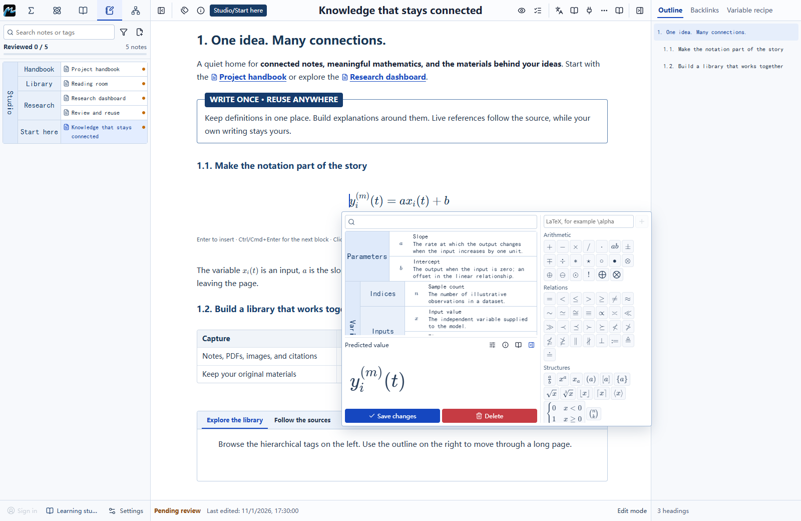
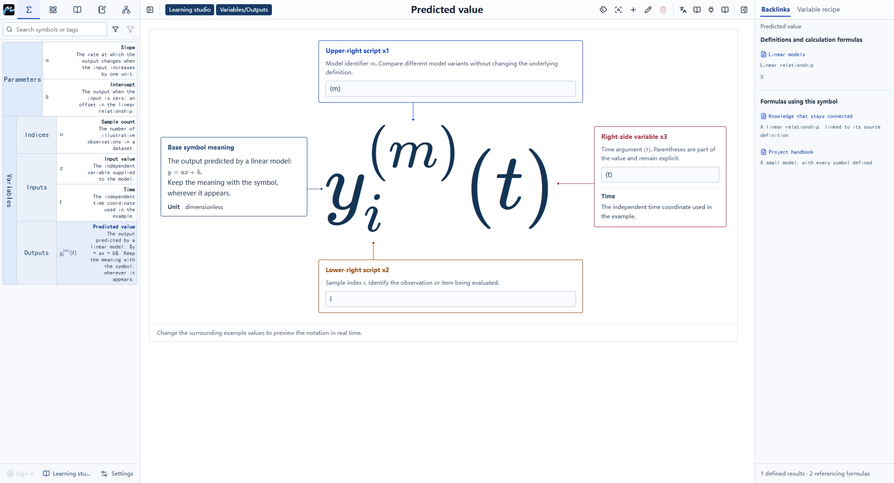
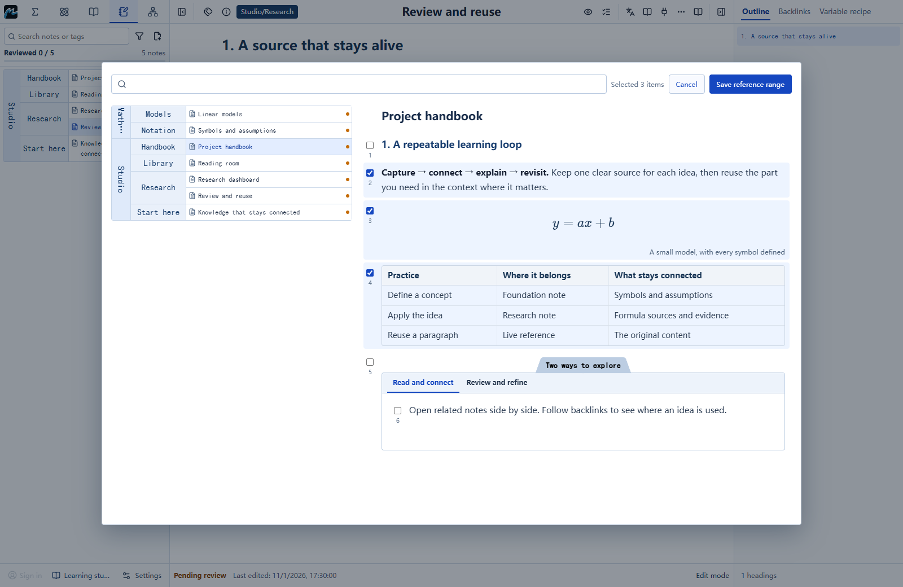
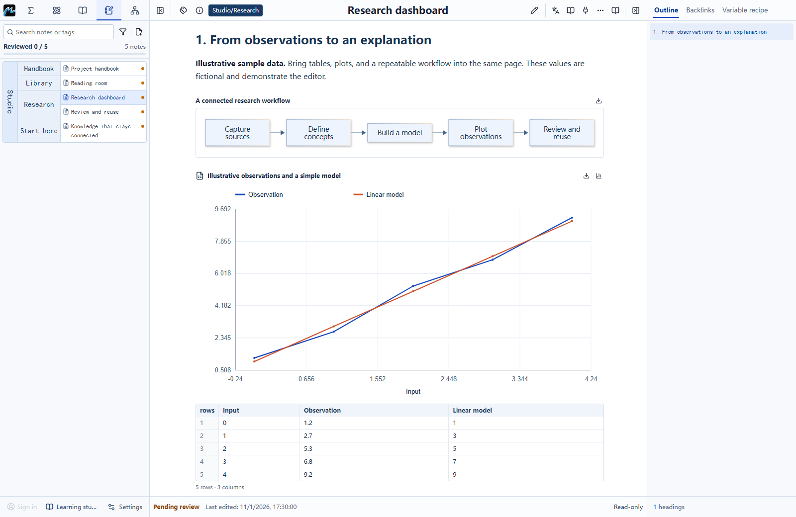
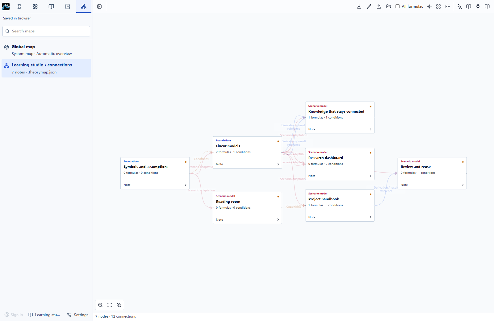
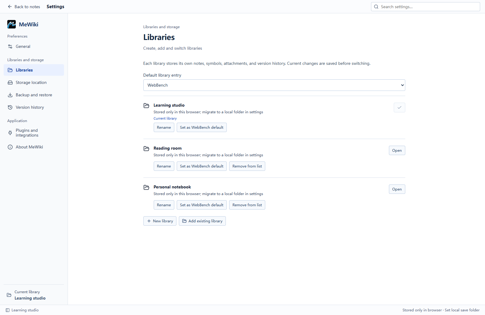

<div align="center">


<h1>MeWiki</h1>
<h3>知识链接万物</h3>

本地优先的个人 Wiki，让页面、术语、公式与来源保持连接。

<p>
  <a href="LICENSE"></a>
  <a href="https://nodejs.org/"></a>
  <a href="#资料保存在你选择的地方"></a>
  <a href="#中英文界面"></a>
</p>

[产品理念](#产品理念) · [功能画廊](#功能画廊) · [快速开始](#快速开始) · [使用手册](docs/wiki/README.md)

[简体中文](README.md) · [English](README.en.md) · [Logo 与应用图标](docs/BRANDING.md)

</div>

MeWiki 是一个开源的本地 Wiki 文档编辑与知识管理应用，适合个人知识库、技术文档、学习笔记与研究记录。在基础理论中维护定义，在研究记录中使用它；用词典解释术语与符号，用内容引用和理论地图连接想法与来源。

首次打开附带完整中文手册和通用示例，从一篇笔记即可开始。


## 产品理念

**知识链接万物，从让每一条记录有据可循开始。** MeWiki 围绕四个想法设计：

- **让知识彼此连接。** 页面链接、反向链接和理论地图，把一条定义与使用它的笔记、公式和条件放回同一个上下文。
- **在来源维护，在多处复用。** 一段说明、一组公式可以被多篇笔记引用；来源更新后，各处显示当前内容，自己的评论保留在当前页面。
- **让表达贴近思考。** 文字、数学记号、数据图表和参考资料共处一页；术语和符号可以查看含义，推导过程可以追溯基础。
- **让积累留在自己手中。** 选择本地资料库目录，使用版本历史、JSON / Markdown 导出和含附件备份，持续整理与迁移自己的资料。

一个常见的使用过程是：**收集资料 → 解释概念 → 建立联系 → 复用与分享**。保存一篇 PDF，记下阅读笔记，为术语和符号建立定义，再把关键段落引用到研究记录，最后导出需要分享的图文。

## 核心能力

| 你想做的事 | MeWiki 提供的方式 |
| --- | --- |
| 修改一处内容，相关页面同步更新 | 引用另一篇笔记的多个内容块，在当前位置显示来源的最新内容 |
| 让概念与数学记号都有解释 | 独立术语词典与符号词典、别名和缩写引用、位置说明、可视化角标与公式来源 |
| 把文字和参考资料放在一起 | 图片、音视频、PDF、普通附件、网页卡片和 DOI 元信息 |
| 整理数据与推导过程 | CSV/Excel、数据图表、Mermaid、手绘与理论地图 |
| 分开管理个人和项目资料 | 多个本地资料库、窗口隔离、版本历史与含附件备份 |
| 把笔记整理成可分享的图片 | PNG/JPEG 图文导出、多页与长图、封面、个人模板与配套文案 |
| 从其他程序带入上下文 | 版本化宿主 SDK、可本地安装的声明式插件，保留外部内容的来源定位 |

## 功能画廊

### 概念有定义，公式有含义

为术语记录规范名称、英文、缩写与别名，在正文输入 `#` 选择引用形式；为符号说明本体、上下角标和变量的含义。阅读时点击引用，就能在当前页面查看解释。

公式编辑器支持选择词典符号、可视化角标、运算符键盘、连续输入、复制粘贴、拖动排序和 LaTeX 实时预览。

<table>
  <tr>
    <td width="50%"></td>
    <td width="50%"></td>
  </tr>
  <tr>
    <td align="center"><strong>可视化公式编辑</strong><br />符号、角标、运算符与 LaTeX</td>
    <td align="center"><strong>可解释的符号词典</strong><br />位置说明、定义结果与使用关系</td>
  </tr>
</table>

### 引用的是来源，显示的是内容

选择另一篇笔记中的段落、公式、图片或标签页，直接在当前页面显示。来源选择器渲染完整内容，方便阅读和勾选；来源改名或更新后，引用继续跟随稳定标识。



引用区域只读，修改时回到来源页面。反向链接帮助找到使用处；删除来源会保留提示，循环引用受到检查。详见[链接与内容引用](docs/wiki/07-links-and-references.md)。

### 一篇笔记，容纳多种资料

阅读 PDF、保存 DOI 文献信息、嵌入媒体，把数据表、图表和流程图放进正文。需要保留原件时，可保存到本地资料库，并随含附件备份一起迁移。



### 看清知识关系，保持资料边界

理论地图把页面、公式与条件连接起来；多个资料库让个人和项目资料分别保存，共用同一套程序。每个窗口保持自己的资料库。

<table>
  <tr>
    <td width="50%"></td>
    <td width="50%"></td>
  </tr>
  <tr>
    <td align="center"><strong>理论地图</strong><br />全局视图、主题地图与本篇推导</td>
    <td align="center"><strong>多资料库</strong><br />独立目录、窗口选择与备份恢复</td>
  </tr>
</table>

### 从自己的笔记，到可分享的图文

安装并启用随附的“社交图文导出”插件，从笔记菜单打开独立导出标签页。选择内容、画幅和模板，生成预览，再下载 PNG、JPEG 或含配套文案的图片 ZIP。可以保存、导入和导出个人模板，供下一篇笔记继续使用。详见[图文导出手册](docs/wiki/20-social-export.md)。

### 按需连接其他工具

通过“设置 → 插件与集成”管理随附插件，也可从本地 JSON、ZIP 或 `.mewiki-plugin` 安装声明式内容插件和导出模板。外部卡片保留来源定位；停用插件后，已有笔记内容继续保留。开发者可从[插件开发入口](docs/plugins/README.md)和[宿主 SDK](docs/integrations/README.md)接入。

截图使用通用示例和虚构资料，不包含个人研究笔记或附件。

## 快速开始

需要 **Node.js 22.13 或更新的受支持版本**、npm 和 Git。

```sh
git clone https://github.com/tojayon/MeWiki.git
cd MeWiki
npm ci
npm run build
npm start
```

打开 **[http://127.0.0.1:5280](http://127.0.0.1:5280)**，保持终端运行。也可以下载源码 ZIP，解压后在项目目录执行后三条命令。

Windows 用户可双击 `Start-MeWiki.bat`；通用启动器为 `node scripts/start-mewiki.mjs`，会准备依赖、构建并打开浏览器。更新源码后重新构建并重启 MeWiki 服务。

首次安装和更新依赖需要网络；安装完成后可离线编辑并查看本地资料，在线媒体与元信息查询仍需要网络。当前主要验收环境是 **Windows + Microsoft Edge**，其他平台仍需补充实机验证。

## 中英文界面

MeWiki 支持 **简体中文 / English**。在“设置 → 通用”中即时切换，应用会保存你的选择；菜单、操作提示和日期显示跟随界面语言。

在同页“界面字体”中可导入自己的字体，并[独立调整界面与正文字号](docs/wiki/02-workspace.md#分别调整界面与正文字号)。菜单与笔记可以使用不同大小，按资料库记住，不改变导出模板。

笔记正文、页面标题、词条名称、标签和附件保持原文。完整使用手册当前为中文，英文 README 提供安装与功能概览。

## 资料保存在你选择的地方

| 模式 | 保存位置 | 单个原件上限 | 适合 |
| --- | --- | --- | --- |
| 浏览器模式 | 当前站点的浏览器存储 | 100 MB | 试用与较小资料 |
| 本地资料库 | 你指定的目录，附件原件位于 `assets/` | 1 GB | 长期使用与大附件 |

导入本地文件会复制一份，原文件保留。保存上限不等于预览能力：可预览的格式、编码和大小仍受浏览器及具体内容类型限制，见[媒体](docs/wiki/10-media.md)和[文档与附件](docs/wiki/11-documents-and-attachments.md)。

迁移或更新前，导出一份**含附件 ZIP 备份**，或备份完整资料库目录。纯 JSON 和 Markdown 不包含附件原件。资料库登记保存在 `.mewiki/`；这些本机设置和用户资料不应提交到源码仓库。

## 常见问题

**可以离线使用吗？** 安装完成后可离线编辑笔记、公式和本地附件。网页、在线媒体和 DOI 元信息查询需要网络。

**需要账户或云服务吗？** 当前是本机单用户应用，默认只监听 `127.0.0.1`，直接使用本地资料。云同步、账户和多人实时协作尚未提供。

**可以直接部署到 GitHub Pages 吗？** 完整应用依赖 Node 本地服务提供资料库、附件和导出接口，静态页面托管不能提供这些功能。

**插件支持什么？** 当前支持本地安装的声明式内容和导出模板。可执行脚本、通用编辑器扩展及在线社区目录见[后续计划](docs/plugins/ARCHITECTURE.md)。日常使用无需 WebBench；启用其回放插件并操作来源时，才需要对应服务。

## 文档导航

| 文档 | 从这里了解 |
| --- | --- |
| [完整使用手册](docs/wiki/README.md) | 从第一篇笔记到内容展示、备份和插件 |
| [术语与符号词典](docs/wiki/05-symbol-dictionary.md) / [公式编辑](docs/wiki/06-formulas.md) | 规范名称、缩写、数学记号、角标与来源 |
| [链接与引用](docs/wiki/07-links-and-references.md) | 多块同步引用、反向链接与分屏阅读 |
| [保存与备份](docs/wiki/15-storage-and-backup.md) | 存储位置、历史、冲突与含附件恢复 |
| [插件与外部程序](docs/wiki/19-plugins-and-integrations.md) / [图文导出](docs/wiki/20-social-export.md) | 本地安装、来源定位、图片导出与个人模板 |
| [开发说明](docs/DEVELOPMENT.md) | 项目结构、公共组件与开发约定 |
| [AI 接手指南](docs/AI_HANDOFF.md) | 接续开发顺序、数据边界、隔离验证与下一阶段入口 |
| [插件开发](docs/plugins/README.md) / [生态设计提案](docs/plugins/ARCHITECTURE.md) | 声明式 API v1、本地安装与示例，以及后续社区路线 |
| [开放接口](docs/integrations/README.md) | 外部内容格式、宿主 SDK 和插件接入 |
| [Logo 与应用图标](docs/BRANDING.md) | 圆形标志、方形 App 图标、SVG 与高清 PNG |
| [变更记录](CHANGELOG.md) / [发展计划](docs/ROADMAP.md) | 已有能力与后续方向 |

## 参与开发

```sh
npm run dev        # 开发服务
npm run check      # 翻译校验、代码检查、单元测试和构建
npm run test:e2e   # Edge 浏览器检查
```

应用使用 React 和 TypeScript，字体、PDF 与图形渲染资源随项目本地提供。测试使用隔离资料，开发时不要连接真实资料库。环境配置和完整验证步骤见[开发说明](docs/DEVELOPMENT.md)。

欢迎通过 [Issue](https://github.com/tojayon/MeWiki/issues) 提交可复现的问题或功能建议，提交修改前请阅读[贡献指南](CONTRIBUTING.md)。安全问题请使用已启用的[私密漏洞报告](https://github.com/tojayon/MeWiki/security/advisories/new)，详见[安全说明](SECURITY.md)。

## 许可证

MeWiki 自有源码和文档采用 **[MIT](LICENSE)**。第三方依赖、字体和解码组件分别遵循各自许可，见[第三方声明](THIRD_PARTY_NOTICES.md)。用户笔记、附件和引用资料保留其原有权利归属。
