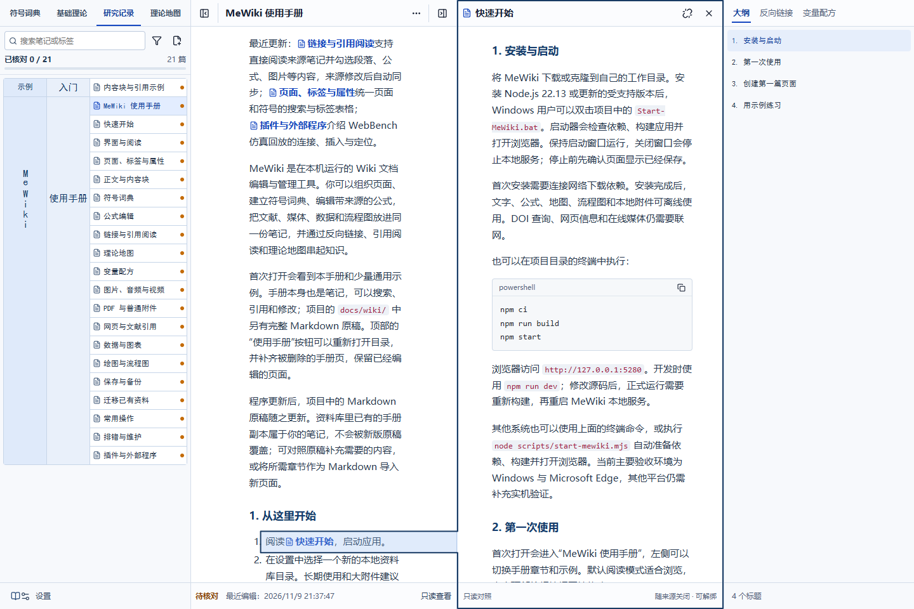
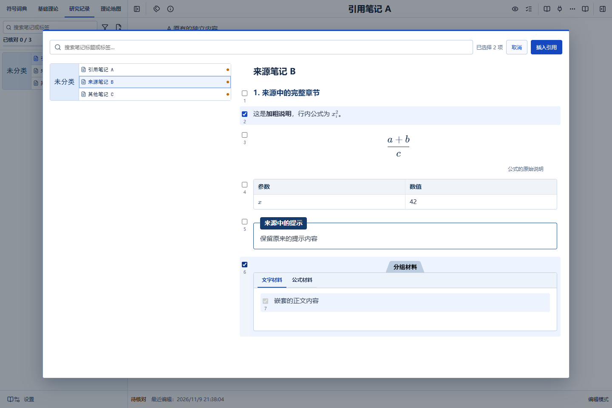

# MeWiki

[GitHub 源码仓库](https://github.com/tojayon/MeWiki)

**把页面、符号、公式与资料放在一起，并让复用的内容跟随来源更新。**

MeWiki 是本地优先的 Wiki 文档编辑与知识管理应用，适合个人知识库、技术文档、学习笔记与研究记录。你可以用层级标签组织页面，在文档中解释数学符号、记录公式来源、阅读 PDF，再把相关段落或公式同步引用到其他页面。

[使用手册](docs/wiki/README.md) · [English overview](README.en.md) · [贡献指南](CONTRIBUTING.md) · [发展计划](docs/ROADMAP.md)



## 可以做什么

- **组织知识**：基础理论与研究记录、层级多标签、搜索、属性、大纲与核对状态。
- **复用内容**：页面链接、反向链接、多面板阅读；原位引用另一篇笔记的多个内容块，跟随来源更新。
- **整理数学表达**：符号词典、本体与角标说明、可视化公式与 LaTeX、公式项复制粘贴和拖动、结果与输入来源。
- **保存资料**：图片、音频、视频、PDF、附件、网页卡片与 DOI 文献元信息；支持在线引用及下载保存。
- **表达数据与流程**：CSV/Excel 数据、图表、Mermaid、手绘与 SVG。
- **分开管理资料**：多资料库、目录保存、历史恢复、含附件备份；每个窗口保持自己的资料库。
- **连接其他程序**：版本化开放接口与可选插件。WebBench 回放插件可保存和打开真实实验位置。

笔记和符号的选择入口使用同一套标签分类表格。引用内容时，左侧选来源，右侧直接阅读已渲染的正文，在段落、公式或图片旁勾选，再从顶部插入。



## 快速开始

需要 Node.js **22.13 或更新的受支持版本**和 npm。在下载或克隆后的项目目录运行：

```sh
npm ci
npm run build
npm start
```

打开 [http://127.0.0.1:5280](http://127.0.0.1:5280)，保持终端运行。Windows 也可以双击 `Start-MeWiki.bat`；通用启动器为 `node scripts/start-mewiki.mjs`，会准备依赖、构建并打开浏览器。

首次打开内置完整中文手册与通用示例。先在设置中配置一个本地资料库，再创建自己的页面。首次安装和更新依赖需要网络；安装完成后可离线编辑并查看本地资料，DOI、网页信息与在线媒体仍需要网络。

开发使用 `npm run dev`。端口被占用时，可执行 `npm run dev -- --port 5281` 或 `npm run preview -- --port 5281`。更新源码后重新构建并重启服务。当前主要验收环境为 Windows 与 Microsoft Edge；其他平台仍需补充实机验证。

## 资料保存在哪里

| 方式 | 保存位置 | 适用情况 |
| --- | --- | --- |
| 浏览器模式 | 当前站点的浏览器存储 | 试用和较小资料，单附件最多 100 MB |
| 本地资料库 | 用户指定的目录，原件位于 `assets/` | 长期使用和大附件，单原件最多 1 GB |

导入本地文件会复制一份到资料库，原文件保留。1 GB 是本地原件保存上限，预览能力还受格式、编码和浏览器限制，见[媒体](docs/wiki/10-media.md)及[附件说明](docs/wiki/11-documents-and-attachments.md)。迁移请使用含附件 ZIP 或完整资料库目录；纯 JSON 和 Markdown 不包含附件原件。

个人与项目资料可放在不同资料库，共用同一程序。服务登记保存在 `.mewiki/research-library-settings.json`。资料文件名 `research-library.webbench.json` 和相关协议名为兼容既有格式而保留，MeWiki 独立运行不依赖原项目目录。

默认内容仅包含手册和通用示例。读取已有资料时不会补入研究模型或重写正文，已删除的示例也不会在刷新后重新出现。

当前提供本机单用户运行，不包含云同步、账户或多人实时协作。应通过 Node 本地服务运行；直接把 `dist/` 放到 GitHub Pages 不能提供本地资料库与媒体服务。

## 文档与开发

| 文档 | 内容 |
| --- | --- |
| [完整使用手册](docs/wiki/README.md) | 从启动、编辑、公式到媒体、备份及插件 |
| [内容同步引用](docs/wiki/07-links-and-references.md) | 多块选择、同步范围、标签页与导出 |
| [开发说明](docs/DEVELOPMENT.md) | 目录结构、公共组件、资料与渲染约定 |
| [开放接口](docs/integrations/README.md) | 外部内容格式、SDK、插件和宿主集成 |
| [贡献指南](CONTRIBUTING.md) | 本地开发、验证、问题与 PR |
| [变更记录](CHANGELOG.md) | 已整理的功能与待发布变更 |
| [开源准备材料](docs/open-source/README.md) | 发布清单、待处理事项、首发文案 |

```sh
npm run check
npm run test:e2e
```

第一条运行代码检查、单元测试和构建；第二条使用 Edge 检查界面，并使用临时资料。日常开发不需要 WebBench、回放服务或 Python，WebBench 插件的真实来源操作需要另外启动其服务。

## 许可证

MeWiki 自有源码与文档采用 [MIT](LICENSE)。第三方依赖、字体和解码组件分别遵循各自许可，见[第三方声明](THIRD_PARTY_NOTICES.md)。仓库中的许可证不改变用户笔记、附件或引用资料原有的权利归属。
