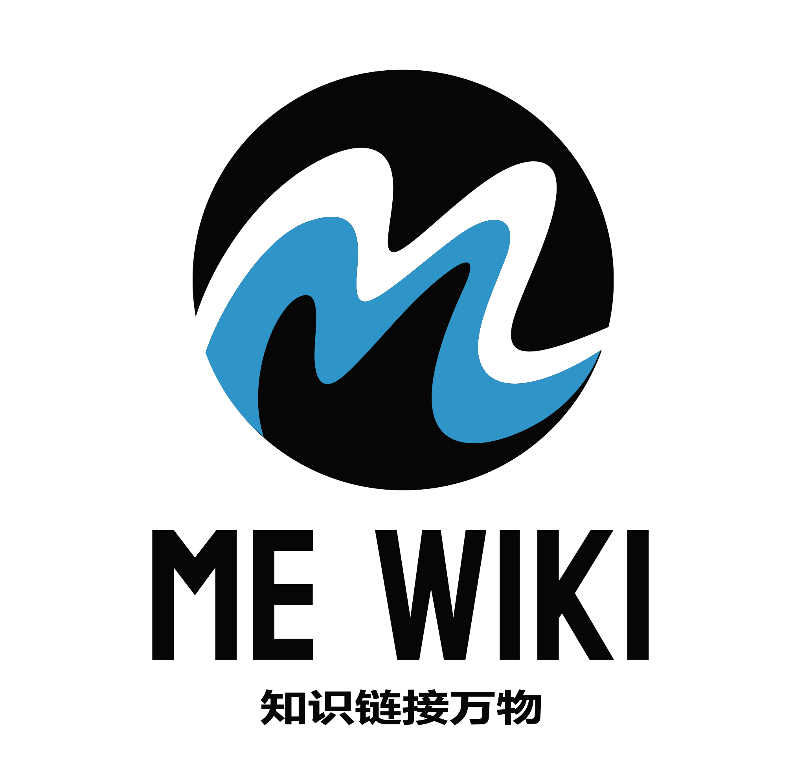

# MeWiki Logo 与应用图标

MeWiki 使用黑、白和蓝色的 M 笔画作为品牌标志，产品理念为“知识链接万物”。浏览器标签页和项目 README 使用圆形 Logo；应用导航、设置页、桌面应用和主屏幕快捷方式使用方形图标。完整 Logo 用于产品介绍、文档和宣传材料。SVG 中的图形与文字均为矢量路径，可直接缩放，不依赖外部字体或图片。

方形图标按方形画幅重新延展笔画：左下笔画顺势延伸到画幅下方，右侧蓝白飘带向右延续，边缘由方形或系统圆角统一裁切。圆形 Logo 的内部截断弧线不再作为方形图标的收尾；中间 M 的识别特征与品牌配色保持一致。白底版本采用同一轮廓，以蓝黑笔画呈现。

| 完整 Logo | 圆形标志 | 应用图标 |
| --- | --- | --- |
|  |  |  |

## 选择文件

| 场景 | 文件 |
| --- | --- |
| 产品介绍、文档，透明底 | [完整 Logo SVG](../public/brand/mewiki-logo.svg) |
| 浅色底展示、印刷排版 | [白底 Logo SVG](../public/brand/mewiki-logo-white.svg) |
| 独立圆形标志 | [圆形标志 SVG](../public/brand/mewiki-mark.svg) |
| 浏览器标签页、README 头图 | [紧凑圆形 SVG](../public/mewiki.svg) · [32px PNG](../public/brand/mewiki-favicon-32.png) · [多尺寸 ICO](../public/favicon.ico) |
| 手机 App、桌面应用图标源图 | [满版方形 SVG](../public/brand/mewiki-app-icon.svg) · [1024 × 1024 PNG](../public/brand/mewiki-icon-1024.png) |
| 网页、介绍页、设计稿 | [圆角图标 SVG](../public/brand/mewiki-app-icon-rounded.svg) |
| 白底备选图标 | [白底图标 SVG](../public/brand/mewiki-app-icon-light.svg) |
| 自定义背景或平台合成 | [透明前景 SVG](../public/brand/mewiki-app-icon-foreground.svg) |

手机应用源图使用不透明的满版方形，由目标平台裁切圆角。圆角 SVG 适合直接展示；透明前景应配深色背景。浏览器标签使用圆形 SVG，并提供带透明四角的 16、32、48 像素 PNG 与多尺寸 ICO；派生时去掉原圆形标志的外围留白，让小尺寸更清晰。主屏幕快捷方式继续使用方形的 180、192、512 像素 PNG。图标内不放文字，名称由应用或系统显示。

品牌蓝为 `#2F94C7`，方形底色为 `#080A0D`。请保持原有比例，不拉伸笔画；浅色界面中保留黑底，以保持小尺寸辨识度。

## 项目内使用与维护

SVG 原件位于 `public/brand/`，应用直接读取这些本地资源。左侧导航、设置页和关于页使用方形图标；中英文 README 以圆形标志、产品名和理念为首页，并展示当前界面的示例截图。另提供[产品介绍横幅](assets/hero.svg)，其中同样使用圆形标志。完整 Logo 的文字已转为轮廓，不需要安装额外字体。

修改 SVG 后，在项目根目录执行：

```powershell
npm run brand:generate
npm run brand:check
```

生成脚本使用项目已有的 Sharp 依赖，从两份原件分别生成资源：

- 圆形原件 `public/brand/mewiki-mark.svg`：派生 `public/mewiki.svg`、`mewiki-favicon-{16,32,48}.png`、`public/favicon.ico` 和产品介绍横幅。
- 方形原件 `public/brand/mewiki-app-icon.svg`：派生圆角、白底和透明前景 SVG、各版 1024px PNG、`mewiki-icon-*.png` 与 `public/apple-touch-icon.png`。圆角版对背景和笔画整体裁切，避免延伸笔画溢出圆角。

横幅布局在 `scripts/branding/hero-template.svg` 维护；圆形标志从原件注入，无需复制曲线路径。`npm run check` 包括派生资源一致性检查。修改浏览器图标时，同步更新 `index.html` 中 SVG、PNG 和 ICO 的版本参数，以刷新标签页图标缓存。

浏览器主屏幕应用元信息在 `public/manifest.webmanifest`，图标链接在 `index.html`。这些标志文件不属于用户资料库，也不会写入、替换或导出到用户笔记。没有新增后台离线缓存，笔记与附件仍按原有本地资料库方式使用。
